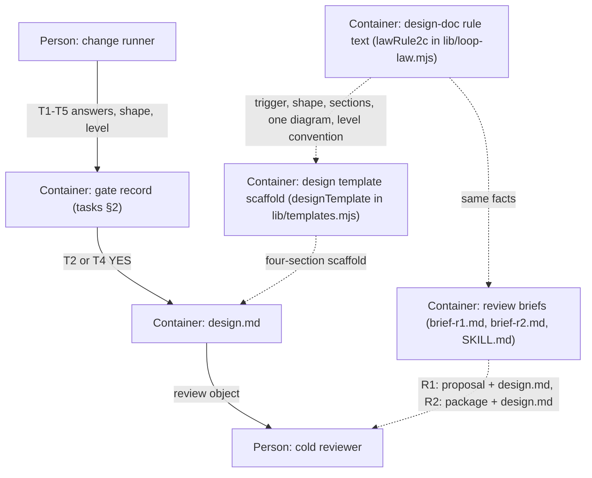

# Design — design-docs

## Level

Container. The bet is about the design phase's artifact pipeline — which artifacts exist after the gate runs, and who writes and reads them — not about the internals of any single module (Component) or the loop's external boundary (Context). A Container view of gate → shape → design.md → reviews is exactly the surface that the law text, the template, and the two review briefs must keep in agreement; the Code level is banned (too fine, rots fastest).

## Diagram

## Boundaries

- Container: gate record (tasks §2) — the five T1–T5 answers plus the chosen shape and, for design.md, the C4 level and why; must not know the template's section text or any brief's checklist.
- Container: design.md — the four-section design document instantiated from the template when the gate answers T2 or T4 YES; must not know enforcement machinery (no validator door exists for it) or how briefs phrase their checks.
- Container: design template scaffold (designTemplate in lib/templates.mjs) — the fixed four-section scaffold carrying exactly one mermaid flowchart; must not know any change's specifics or the trigger logic (those belong to the gate and the law).
- Container: design-doc rule text (lawRule2c in lib/loop-law.mjs) — the adopter-generic statement of trigger, shape choice, four sections, one diagram, and level convention, rendered into every statement surface; must not know template rendering or brief wording.
- Container: review briefs — R1's review object grows to proposal.md + design.md (when the gate produced one); R2's package object gains design.md plus one alignment bullet; must not restate the law's canonical text (they cite it).
- Person: change runner — runs the gate, instantiates design.md, dispatches reviews; must not review their own artifacts (rule 2b).
- Person: cold reviewer — reads the artifacts at their pinned paths and reports advisory findings; must not edit change artifacts or the loop's source.

## Alternatives

- Prose only (status quo — a short design above the tick for every YES): rejected — an architecture bet deserves a reviewable artifact with a diagram and a level claim the briefs can actually check; prose above a tick has no shape to review.
- design.md on every change (always-artifact): rejected — T1/T3/T5-only changes carry no architecture bet; a mandatory document would rot and add ceremony without a risk to hold.
- Validator enforcement (a machine door for missing or bad diagrams): rejected — charter-only for now; if reviews keep finding missing or bad diagrams, that becomes a process finding and a door later.
