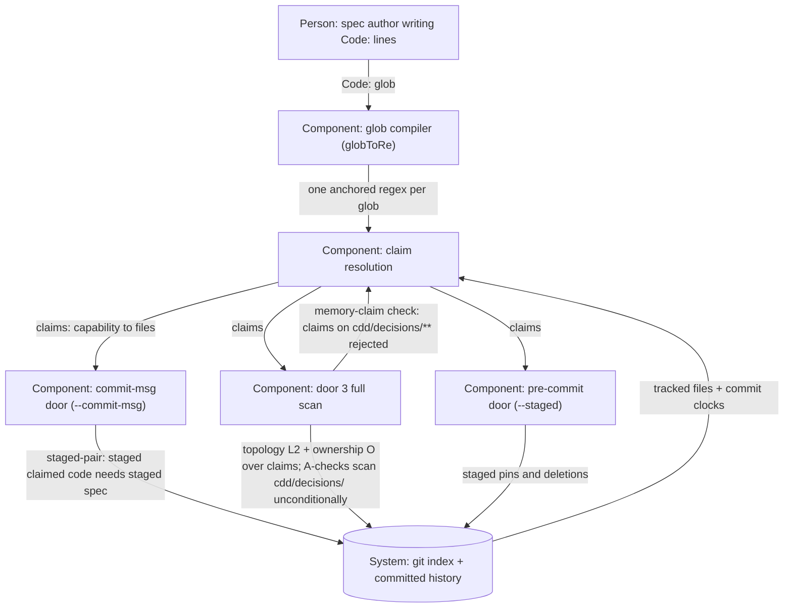

# Design — guard-glob-fix

## Level

Component. The risk lives in the claim-resolution pipeline inside one script (`scripts/spec-drift.mjs`): how a `Code:` glob compiles to a regex, what files that regex claims per capability, and what the three door modes then bind (staged pairs, topology staleness, single ownership). Fixing the compiler changes the input to every door check across the whole corpus at once; the remedy decides which files a `Code:` line may lawfully claim at all. No external system boundary moves — hooks, invocation sites, and the store copy stay as they are.

## Diagram

## Boundaries
- Author (Person: spec author writing Code: lines): names implementation surface only — files whose travel the doors should bind; must not list decision memory (`cdd/decisions/**`) whose governance is already unconditional (A0/A1/A2) — a memory entry binds staged-pair and topology into reconfirm deadlocks (PF-19) with no offsetting enforcement.
- Glob compiler (GR, Component): translates one `Code:` glob to one anchored regex with precise glob semantics — `[...]` spans become character classes (`!` leading → `^`), `*` becomes `[^/]*`, `**` (split first) joins segments with `.*`, every other regex metacharacter is escaped so literals stay literal; must not double-escape a translated wildcard (PF-20's disease: every star glob compiled to a demand for a literal `[` and silently claimed zero files) and must not broaden literals into patterns (over-claim). A malformed class span with no closing `]` is literal text.
- Claim resolution (CR, Component): maps tracked files to owning capabilities via compiled globs — the single input to every door check; must not itself distinguish memory files from implementation files: that distinction is authoring law, enforced by the full scan's memory-claim check, not by resolution logic.
- Pre-commit door (PC, Component): polices staged content — pins resolve, staged deletions of pinned tests carry their spec; must not see committed-history topology (PF-18's law).
- Commit-msg door (CM, Component): polices the commit being made — staged claimed code without a staged spec of the capability reds, mechanical lane exempt; with honest Code lines it never fires on decision memory, so a staged ADR reconfirmation with nothing claiming it passes green — the lawful reconfirm path (PF-19's residual corner closed).
- Door 3 full scan (FS, Component): owns topology L2, ownership O, the A-checks (which scan `cdd/decisions/` unconditionally — ADR governance never depended on Code claims), and the new memory-claim check: an open-delta `Code:` line naming decision memory — by `cdd/decisions/` prefix or by compiled claim — reds unconditionally at the author's own draft gates; a living line reds the same way UNLESS an open change of the same capability is correcting that very requirement (matched by requirement heading) and whose restated Code line claims no decision memory, in which case the scan prints one informational skip line and stays green — a correction that keeps the claim reds both lines — a skip is never silent (the placeholder-skip law). The same under-correction predicate exempts the claim from the travel doors (topology L2 and the staged-pair check consume the same exempted claim set): the correction clears the claim at the archive pair-commit, so demanding spec travel on it mid-Close is transition noise — this is also what keeps the archive window lawful for staged ADR reconfirmations while the legacy claims still stand. The exemption keeps this change's own archive window green end to end: the check lands in the feature commit, the corrected Code lines land only in the archive commit, the three adr-topology reds at tip (0005/0006/0007 out-committing the adr spec once the class glob activates) are transition noise under correction, and the decisions-home pin (DH6) asserts the real-repo full scan exits 0 throughout.
- Git (System: index + committed history): stores the index the doors read and the history the full scan walks; must not know cdd semantics — the guard interprets commits, git only records them.

### Fallout inventory — every glob-carrying Code line in the living corpus at tip 24fc6f8 (star, class, and the one literal path caught by the same sweep), what it claims once the compiler is fixed, and the per-conflict decision. Repo-only handles for the adopter: PF-nn = process-finding ids in this store's cdd/backlog.md; A0/A1/A2/L1/L2 = the drift guard's check tags (ADR status law, citation-on-touch, reconfirm-after-change, pin resolution, spec-code co-travel); DH6 = scenario 6 of the decisions-home acceptance pin, which asserts the real-repo full scan exits 0.

| Site (living spec) | Glob | Claims when fixed | Conflict under fixed compiler | Decision |
|---|---|---|---|---|
| gherkin/spec.md:286 (Loop law names three review points) | `cdd/decisions/0008-*.md` | 1 file (ADR-0008) | staged-pair binds any 0008 edit to a staged gherkin spec; tip-green (gherkin spec merged at tip) | remove from Code line — lib/pin surface already named there |
| gherkin/spec.md:344 (Tasks template scaffolds review tasks) | `cdd/decisions/0008-*.md` | 1 file | same | remove |
| gherkin/spec.md:380 (Design gate record lands before the proposal) | `cdd/decisions/0008-*.md` | 1 file | same | remove |
| gherkin/spec.md:402 (Advisory-findings ADR is drafted) | `cdd/decisions/0008-*.md` | 1 file | same | remove |
| gherkin/spec.md:446 (Single-source ADR is drafted) | `cdd/decisions/0009-*.md` | 1 file (ADR-0009) | same | remove; name the real bound surface — `tests/acceptance/single-source-law.test.js` pins both scenarios |
| gherkin/spec.md:541 (Reviewer-independence ADR is drafted) | `cdd/decisions/0010-*.md`, `0008-*.md`, `0009-*.md` | 3 files | same | remove all three; `tests/acceptance/loop-law-hardening.test.js` stays and `tests/acceptance/reviewer-independence.test.js` is added — 3 of the requirement's 4 scenarios pin it, the living line under-claimed |
| gherkin/spec.md:879 (Re-tick and pin-realism ADR is drafted) | literal `cdd/decisions/0011-...md` | 1 file — already live | PF-19's proven collision (staged-pair red on A2's prescribed reconfirm) | remove; pin test stays |
| adr/spec.md:37 (Product ADRs live in the store's decisions home) | `cdd/decisions/000[1-7]-*.md` | 7 files (0001–0007) | topology L2 red ×3 at tip: 0005 (amended 1c5ef8a design-docs), 0006 and 0007 (reconfirmed 24fc6f8 law-guard-fixes) all out-commit the adr spec's last commit 28423ec; proven by fixed-compiler probe scan | remove; `tests/acceptance/decisions-home.test.js` stays — the 11-ADR governance it pins runs through the A-checks, which never read Code claims |

Consequences: fixing the compiler without the Code-line corrections activates 11 ADR claims across two capabilities (0001–0007 → adr, 0008–0011 → gherkin), producing 3 topology reds at tip and an 11-wide reconfirm collision — so both halves travel in this one change. ADR-0001's own `scripts/**` already governed the guard script and keeps doing so — the activated `cdd/scripts/**` claim (gherkin) is the spec-side twin of that ADR surface: from now on every commit moving `scripts/spec-drift.mjs` or its copy must carry a gherkin spec, which this change's delta is. After the corrections, the only star globs left in the corpus are `cdd/scripts/**` (already correct under both compilers) and the sandbox globs the new pins create. The guard is green at tip with the fixed compiler (the change's core proof); the adr capability's staleness heals because the archive pair-commit re-commits its merged living spec. A2 during Close: the feature commit moves `scripts/spec-drift.mjs` past ADR-0001 (`scripts/**`), ADR-0006 and ADR-0007 (both claim the script) — their reconfirmations ride the archive commit, which now stages no unlawfully claimed file (nothing claims ADRs anymore).

## Alternatives

- Design B (backlog option a): keep the ADR paths in Code lines and teach the doors to exempt `cdd/decisions/**` from staged-pair and topology L2. Rejected: it institutionalizes claimed-but-inert Code entries — the exact pathology PF-20 exposed, one level up: the doors would silently ignore part of every claim set, and `Code:` would stop meaning "the surface the doors bind".
- Doors recognize a reconfirm-only commit shape (e.g. a `Reconfirm:` trailer or a staged-set heuristic) exempting ADR-only commits. Rejected (backlog option named it): new marker semantics, more guard machinery, and it keeps the underlying over-claim — the collision returns for every ADR edit that is not a reconfirmation.
- Fix the compiler only and pay per-site remedies (adr spec travels every time an ADR out-commits it; every ADR-touching commit stages a claiming spec). Rejected: leaves PF-19's residual corner open — post-Close reconfirmations with no archive commit still have no lawful path — and the 3 topology reds at tip would demand the adr spec ride this change anyway.
- Remove the ADR paths and leave the affected requirements claiming nothing. Rejected: a requirement whose only Code entry was ADR paths (Single-source ADR is drafted) would claim zero files — recreate the honest-claim invariant by naming the enforcement pin (director refinement: claim the enforcement, not the memory).
- Leave globToRe broken and rewrite the 8 Code lines as literals. Rejected: the compiler bug stays for every future star/class glob, and the class-glob contract (`000[1-7]-*.md`) has no literal spelling short of naming seven files by hand.
- Reject memory claims unconditionally in every scan (no correction-exemption). Rejected: the check lands in the feature commit but the corrected Code lines only land in the archive commit — the whole archive window would run red on the eight legacy claims, breaking the decisions-home pin (DH6 asserts the real-repo full scan exits 0) and the Close sweep. The exemption honors in-flight corrections exactly as the L2 hint honors an open change claiming the stale file.
- Check only open deltas, never living specs. Rejected: legacy claims in adopting stores would linger silently until some change happens to touch their requirement — the invariant would lack teeth over exactly the corpus it must police.
