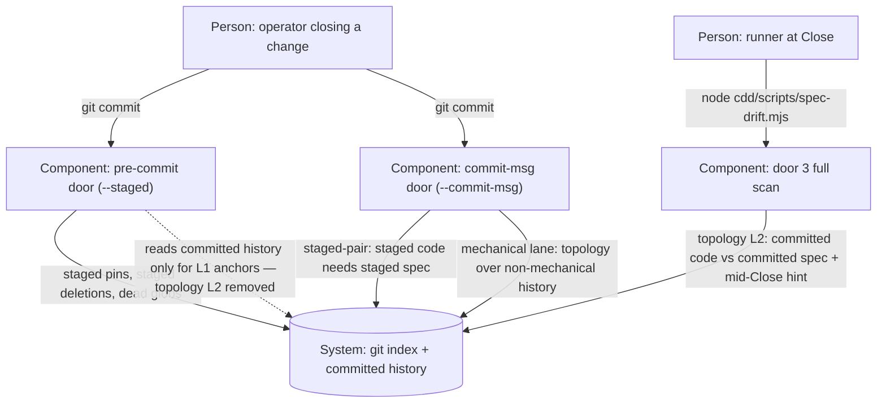

# Design — law-guard-fixes

## Level

Component. The risk is the check-ownership split among the guard's three entry modes — pre-commit (`--staged`), commit-msg (`--commit-msg <file>`), and the door 3 full scan — all components inside one script (`spec-drift.mjs`). No external system boundary moves: hooks, invocation sites, and the store copy all stay as they are.

## Diagram

## Boundaries
- Dev (Person: operator closing a change): issues both commits of the pair and nothing else; must not know which checks each door runs — for the operator the pair protocol (feature commit, then archive commit) is one indivisible Close step.
- pre-commit door (PC, Component): polices the commit's staged content — staged acceptance-test adds are pinned, staged deletions of pinned tests carry their spec, dead globs; must not know committed-history topology (it cannot see the staged living-spec merge that resolves it — the archive pair-commit's second commit stages the spec without code).
- commit-msg door (CM, Component): polices the commit being made — staged code without a staged spec of the capability, mechanical lane exempt; must not know the archive operation or delta claimants.
- Ops (Person: runner at Close): runs the full scan at checkpoints (draft-green, Close, sweep); must not know hook wiring — it consumes the guard as a library command, never as a git hook.
- door 3 full scan (FS, Component): the only owner of committed-history topology L2 plus the mid-Close hint for open changes; must not know hook wiring beyond hook-health advice.
- Git (System: index + committed history): stores the index the pre-commit and commit-msg doors read and the history the full scan walks; must not know cdd semantics — the guard interprets commits (mechanical-vs-feature, lastCommit clocks), git only records them.
## Alternatives

- Teach the pre-commit door to honor a claiming ARCHIVED delta mid-pair (detect `cdd/archive/<stamp>-<name>` specs as claimants while the pair is open). Rejected: it encodes the archive operation's mid-state into the door, widens the ownership check the O rule explicitly excludes (`archive/ is frozen history and never a claimant`), and still leaves the pre-commit topology judging committed history it is about to make stale — a check that can only fire wrongly at exactly one commit.
- Keep topology in pre-commit and special-case "no code files staged" (the archive commit shape). Rejected: a shape whitelist hides the invariant — it passes the archive commit but keeps the unreachable-red for any other staged-spec-without-code commit, and the rule "topology reads history that cannot contain this commit's spec merge" remains violated.
- Move the living-spec merge out of the pair (commit merged spec first, then archive move). Rejected: reorders archiveChange's atomic output and still has a window where committed code out-commits the committed spec.
