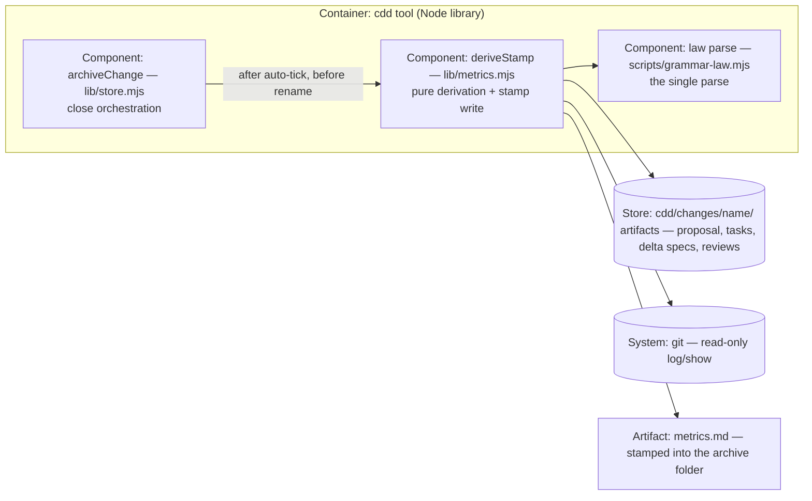

# Design — 20261024-metrics-stamp

## Level

Component. The bets are seams inside the cdd tool container: where derivation lives (a new lib/metrics.mjs vs inline in lib/store.mjs), which parse it consumes (canonical scripts/grammar-law.mjs, per the single-parse law), and what the stamp trusts (a mechanical cross-check, not author self-report). Context and Container zoom would show only "archive stamps a file"; the Code level is banned (rots fastest).

One timing fact shapes the design: at stamp time — inside archiveChange, before the rename — the archive commit does not exist yet, so every git fact is stamped as-of-stamp by construction. The archive commit only ever ticks Close boxes ([ ] → [x]); an x → [ ] transition cannot appear after stamp time, so commit-visible re-ticks are complete as-of-stamp.

## Diagram

## Boundaries

- archiveChange (Component): orchestrates Close — strict gate, delta merge, Close auto-tick, rename — and calls the derivation at exactly one point; must not know how any field is derived or what a findings file looks like.
- deriveStamp (Component): derives every stamped field and writes metrics.md; must not know the archive flow (validation, merge, tick, rename) and must not write anything but metrics.md.
- law parse (Component): the single parse of spec and task text (parseSpecModel, splitTaskSections, TASK_ITEM); must not know metrics exist.
- Store artifacts (Store): read-only inputs — proposal.md, tasks.md, specs/*/spec.md, reviews/*.md; must not know they are measured.
- git (System): read-only log/show over the change's paths; never written, never committed to.
- metrics.md (Artifact): derived output stamped by the op; never hand-edited, never read by validation or the guard.

## Alternatives

- Inline derivation in lib/store.mjs — rejected: store.mjs stays the store mutator; the derivation is pure read-only logic; the module split mirrors lib/backlog.mjs and lib/adr-ops.mjs.
- Post-archive stamping (a second pass or new op once the archive commit exists) — rejected: no new op is ledger law (PF-33), and post-hoc stamping reintroduces the PF-14/PF-26 self-report gap (a human authors it, not the door).
- Blank-with-reason for all git fields — rejected: commits-before-archive and commit-visible re-ticks are mechanically true at stamp time; explicit labels carry the honesty without hiding derivable facts.
- parseSpecModel from cdd/scripts/grammar-law.mjs — rejected: that is the byte-identical consumer copy (PF-28); the canonical import is scripts/grammar-law.mjs, the one lib/store.mjs:16 already makes.
