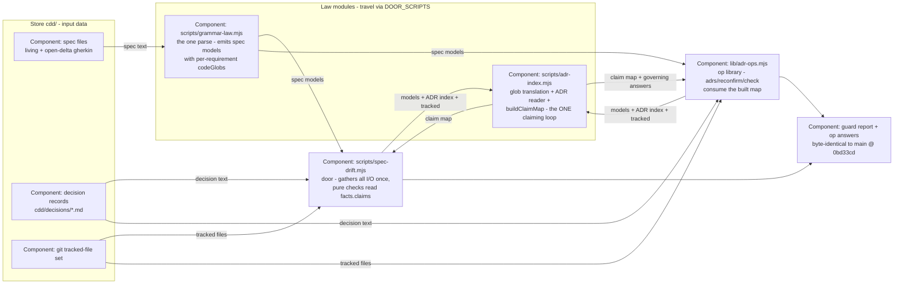

# Design — claim-map

## Level

C4 **Component** level. The risk this change carries is not what the system
promises (both surfaces stay byte-identical) but which module inside the
pi-cdd system owns the shared derivation and what each consumer is allowed
to know — a component-boundary question. Context level is too coarse (the
system has one boundary: the adopting repo); the Code level is banned (it
rots fastest, rule 2c).

## Diagram

## Boundaries

- **SPECS** (input data) — living and open-delta gherkin spec files; must
  not know about any consumer; no store-format change rides this design.
- **ADRS** (input data) — decision records under cdd/decisions/; read-only
  input to the ADR index; must not know about claiming.
- **GIT** (input data) — the tracked-file set each consumer gathers its
  own way; must not know about globs or claims.
- **GRAMMAR — scripts/grammar-law.mjs** (law module, grammar home) — owns
  the single parse whose per-requirement codeGlobs arrive pre-compiled;
  must not know tracked-file sets, ADRs, or which file any glob claims.
  Unchanged by this change.
- **INDEX — scripts/adr-index.mjs** (law module, claim-law home) — owns
  the glob→regex translation, the ADR index reader (the module's only
  file reader), and `buildClaimMap`: the only per-file claiming loop
  among the guard and the ops library (scripts/spec-extract.mjs keeps its
  union-only territory derivation — Non-Goal); must not know door
  reporting, op table formatting, or store write operations.
  `buildClaimMap` itself is pure over its parsed inputs.
- **GUARD — scripts/spec-drift.mjs** (door, the guard) — gathers every
  I/O fact once, calls `buildClaimMap` inside gather, stores the map as
  `facts.claims`; every check (topology, L2, O, A1, A2, memory claims)
  reads the map; must not re-derive a claim, hold a glob matcher, or know
  the op library.
- **OPS — lib/adr-ops.mjs** (op library) — parses open-delta specs via
  `parseSpecModel`, calls `buildClaimMap` for governing and open-claim
  answers; must not hold `globToRe`, a claiming loop, or a private
  Code-line scan.
- **REPORT** (the invariant's observable surface) — guard stdout/stderr/
  exit and the adrs/reconfirm op answers over the live store; must be
  byte-identical to main @ 0bd33cd — this box carries no behavior change,
  only the proof that the refactor moved law, not answers.
## Alternatives

- **Builder home in scripts/grammar-law.mjs** — rejected: the living
  charter there is "the spec model is the single parse"; claim semantics
  are not grammar, and the builder would deepen the existing grammar-law ↔
  adr-index import cycle instead of following it.
- **New law module scripts/claim-map.mjs** — fence-dead: the guard is a
  door script, and every import it takes must travel byte-identical inside
  the store copy; DOOR_SCRIPTS is pinned at 5 with no sixth copy allowed.
- **buildClaimMap as an I/O walker** (root → map, own readdir walks) —
  rejected: the guard's gather already walks and parses every spec for
  models and pins; a walking builder would re-read files and split the
  gather-once law (guard-pure-checks). Pure function over parsed inputs
  instead; the two consumers keep their own (already required) walks.
- **Keep two derivations, add a conformance test** — rejected: a test that
  asserts two implementations agree is a checksum on drift, not its
  removal; the divergence class (glob semantics, exemption lists,
  ordering) stays alive.
