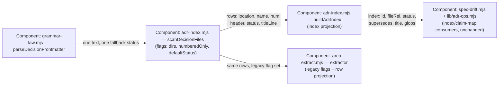

# decision-scan-unify — design

## Level

Component. The risk is not which container owns what (the doors and the
store are settled) nor the system context (no new external surface); it is
which component inside the door-tooling container owns the decision scan,
and what each consumer may know about the scan's flag vocabulary. A
component-boundary question, so the diagram is C4 Component level.

## Diagram

## Boundaries

- Component: grammar-law.mjs `parseDecisionFrontmatter` — parses one text
  with one fallback status; must not know directories, file names, filters,
  or consumers.
- Component: adr-index.mjs `scanDecisionFiles` — owns which files are
  decisions: the ordered directory walk (readdir order per directory,
  dirs in flag order, a dir that does not exist is skipped), the
  four-digit name filter, the one frontmatter parse per file with the
  flagged fallback; must not know ADR ids, claim maps, report shapes, or
  any consumer's projection.
- Component: adr-index.mjs `buildAdrIndex` — owns the index projection
  (`ADR-` id from the row's captured num, `supersedes`/`code` from the
  row's header, title from the row's titleLine with null mapped to the
  empty string, glob split); must not walk directories or parse
  frontmatter itself.
- Component: arch-extract.mjs — owns the extractor projection (`code`
  echo, title via `^#\s+(.+)$` over the row's titleLine with filename
  fallback) and its legacy flag set; must not walk decision directories or
  import the frontmatter parse.
- Component: spec-drift.mjs + lib/adr-ops.mjs — read the index and the
  claim map, unchanged by this design; must not know the scan's flag
  vocabulary or the extractor's projection — their answers ride the
  index and the claim map alone.

## Alternatives

- Move the scan into grammar-law.mjs (rejected: grammar-law is the parse
  law's home, not a directory walker; ADR-0013 already settled that
  decision law lives in adr-index.mjs).
- Parameterize arch-extract's private scan and have adr-index import it
  (rejected: the extractor is a report command, not a law module — the
  guard and the ops library would then depend on a report script; the
  dependency arrow points the wrong way, and the scan would not travel
  into adopting stores from there).
- Have the scan return fully-projected rows per caller (rejected: it would
  push both title laws and both row shapes into the scan, growing the
  vocabulary instead of shrinking it; the scan returns raw material and
  each caller projects).
