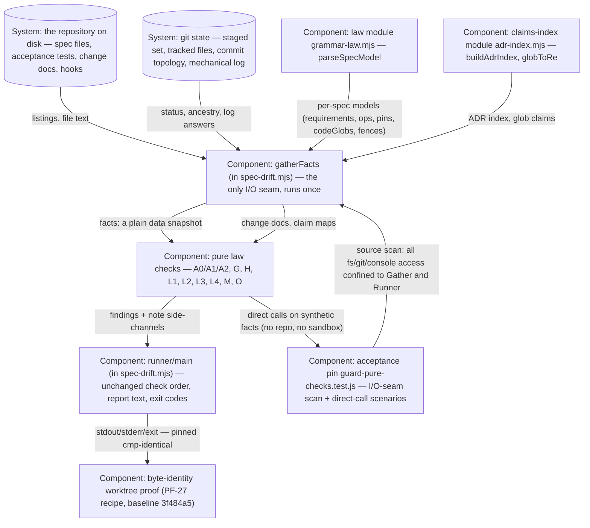

# Design — guard-pure-checks

## Level

Component. The risk lives inside one component: the drift guard door script, whose internal shape changes from interleaved per-law I/O to one gather pass feeding pure check functions with a runner that maps findings to the report. The container boundary around it is fixed by fence — the door-script set stays five, the store copy set travels unchanged, the parse home stays grammar-law — so this change draws no new boundary between components; it moves every filesystem and git access inside the guard behind one seam. The Code level is banned as too fine and fastest-rotting: the internal shape of the facts object and of each pure function is free to change precisely because the pinned surfaces are the laws' inputs (facts only) and outputs (findings only), plus the door's byte-identical observable behavior.

## Diagram

## Boundaries
- The repository on disk (Disk, System): spec files, acceptance test files, open-change docs, hook files — read exactly once per run by the gather pass; no law may touch it directly, not even pin-resolution `existsSync` checks (gather pre-resolves pins into facts).
- Git state (Git, System): staged/pre-commit distinction, tracked files, per-file last commits, ancestry answers, the mechanical log — collected once by the gather pass; laws receive answers, never invoke git.
- Law module (GL, Component: grammar-law.mjs parseSpecModel): unchanged from run 1 — the gather pass is its new sole consumer inside the guard, calling it once per spec file; the module keeps its no-filesystem law (pin resolution and glob claim resolution stay with the guard).
- Claims-index module (AI, Component: adr-index.mjs): unchanged — the gather pass calls buildAdrIndex and compiles claim globs through globToRe exactly as the interleaved code did; no law re-derives claim maps.
- Gather pass (Gather, Component: gatherFacts in spec-drift.mjs): the only I/O seam — every `fs`/`git`/`execFileSync` access in the guard lives inside it (plus argv reading and report writing in the runner, which are the door's own mouth and hands). It is deterministic given a repository state and returns a plain data snapshot: spec listings with per-spec models and resolved pins, acceptance listings, staged/tracked sets, lastCommit and ancestry answers, the mechanical log, hooks presence, open-change claim maps, ADR index, change docs. The scan scenario in the acceptance pin holds this boundary mechanically.
- Pure law checks (Laws, Component: the check functions in spec-drift.mjs): one function per law family over the facts snapshot, returning findings (strings) plus note side-channels (placeholder skips, L4 informational skips, the L2 mid-Close hint trigger); same facts in, same findings out; no fs, no git, no console, no process. Each keeps its real-door acceptance pin — direct-call tests are additional coverage, never replacements (the H1 lesson).
- Runner (Runner, Component: main in spec-drift.mjs): calls the laws in the exact current check order (the `// Checks:` index line and its machine-pinned tag set are untouched), prints informational notes where they print today, maps findings to the exact report lines and exit codes; `main()` sits behind a run-as-script guard so importing the module runs nothing — the direct-call scenarios' door in.
- Byte-identity proof (Proof, Component: worktree run at baseline 3f484a5): one-shot migration proof riding the tick per the spec-model precedent — capture stdout/stderr/exit before the branch's files, apply only the changed files, re-run, cmp all three; it must not be relaxed to "tests green" and must not become a delta scenario (the suites are the durable lock, the cmp is the migration evidence).
- Acceptance pin (Pin, Component: guard-pure-checks.test.js): holds the two durable scenarios — the source scan that confines I/O to gather+runner, and a direct pure-check call on synthetic in-memory facts with no git repository; it must not convert any real-door end-to-end pin into a scan or a direct call.

## Alternatives
- A new `scripts/spec-drift-facts.mjs` module for the gather pass. Rejected: it would be a sixth door script — the fence pins DOOR_SCRIPTS at five and every adopting store copies exactly that set; the gather pass lives inside the guard file as a function, keeping the door self-contained.
- Move the laws into `lib/`. Rejected: the guard must run inside adopting stores from the five copied door scripts alone; `lib/` is host-side tooling the copied door cannot import. Same reason kills any shared `facts` type module.
- Keep the interleaved structure but memoize git/fs access. Rejected: memoization removes duplicate subprocess calls but leaves every check uncallable — tests still build full git sandboxes per scenario, and the I/O seam stays smeared across 630 lines; it answers the symptom (duplicate work), not the structure (checks are not functions of their inputs).
- Laws push findings into a shared issues array (the current shape) instead of returning them. Rejected: a shared mutable array is hidden coupling — a direct call would mutate module state and depend on run order; returning `{findings, notes}` makes the function total over its arguments and honest in tests.
- Convert every smoke.mjs sandbox scenario to direct calls. Rejected: coverage discipline (the H1 lesson from 20261022-ergonomics — sandboxed pins once hid a module-scope ReferenceError that only a real-door pin caught): every law family keeps at least one real-door end-to-end acceptance pin; only sandboxes whose law already holds such a pin may convert, each deletion naming the retained pin.
- Restructure the other door scripts (extractor, store adapters) to consume the facts snapshot too. Rejected: run 3/4 of the sequence owns their shape; here the guard's own structure is the whole scope, and the parse home fence already binds all doors to grammar-law's model.
