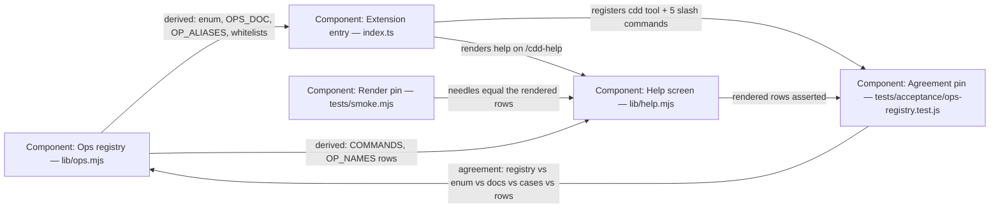

# Design — ops-registry

## Level

C4 **Component** level. The risk is not how the system talks to anything
outside it (Context) or how processes are deployed (Container) — it is which
module inside the extension owns the op table, and what each consuming
component may know about that table. Getting that boundary wrong re-creates
the drift this change deletes (a second hand-maintained copy of the op list),
and the drift lives entirely at component granularity.

## Diagram

## Boundaries

- **Ops registry (lib/ops.mjs)** — one ordered table of op rows (name, was,
  aliases, description, parameters) plus COMMANDS and the derivations
  (OP_NAMES, OPS_DOC, OP_ALIASES); plain data, no I/O. It must not know about
  dispatch mechanics, tool schemas beyond plain JSON fragments, theme
  rendering, or any store path.
- **Extension entry (index.ts)** — registers the tool and the 5 slash
  commands, derives the declaration enum, the help payload (OPS_DOC), the
  legacy op aliases, and each dispatch case's option whitelist from the
  registry; dispatches to lib/ modules. It must not restate any op *list* —
  no enum array, no doc text, no parameter table, no alias map the registry
  owns. Three literal restatements remain, each deliberate: (1) the `case
  "…":` labels of the dispatch switch — the keyed references to registry
  rows; only `case "status":` is required literal (T3e's source scan splits
  the source on it), the other eight stay literal by choice, and the
  agreement pin asserts exactly one case label per registry op and none
  extra; (2) the five `registerCommand("cdd-…")` calls — each command has
  its own description and handler, so a loop over COMMANDS would need
  per-row UI code inside the data module; the pin detects drift between
  them and COMMANDS instead; (3) the tool declaration's description prose,
  which walks the nine ops in readable text — kept byte-identical per the
  behavior-preserving fence, with the pin extended to assert every registry
  op name appears in it, so a future tenth op cannot land unchecked.
- **Help screen (lib/help.mjs)** — renders HELP_LINES, with the two
  "Commands and tools" rows joined from COMMANDS and OP_NAMES. It must not
  hold an op or command literal *in those two rows*. Command mentions in
  other rows of the screen — the `/cdd-archive <name>` step, the
  `/cdd-status` tip, the `/cdd-init` note — are literal instructional
  prose inside HELP_LINES, not the surfaced lists; they teach the workflow,
  so they stay out of scope (only `helpReviewTip` and
  `helpIndependenceLine` are sourced from lib/loop-law.mjs).
- **Agreement pin (tests/acceptance/ops-registry.test.js)** — loads the real
  extension entry and asserts registry ↔ declaration ↔ OPS_DOC ↔ dispatch
  cases ↔ whitelists ↔ help rows ↔ registered commands agreement, exactly,
  nothing extra anywhere. It must not pin doc prose beyond the two rendered
  row strings.
- **Render pin (tests/smoke.mjs S21)** — pins the rendered help rows and
  asserts the ghost command absent. It must not enumerate ops independently
  of the render (its needles are the rendered strings).

## Alternatives

- **Grow lib/help.mjs into the registry home** — rejected: lib/help.mjs is a
  render module in gherkin-capability territory (6 living requirements claim
  it); the registry is extension contract data consumed first by index.ts.
  Hosting contract data inside the renderer inverts the dependency and would
  make index.ts import help.mjs for the declaration enum.
- **Keep the table inside index.ts** (colocate, derive nothing) — rejected:
  the acceptance pin must read the registry without loading the whole
  TypeScript extension through jiti, and the four drifting copies stay four
  copies until an external table forces one truth.
- **Two tables (ops in index.ts, commands in help.mjs)** — rejected: two
  sources again — the exact shape that drifted.
