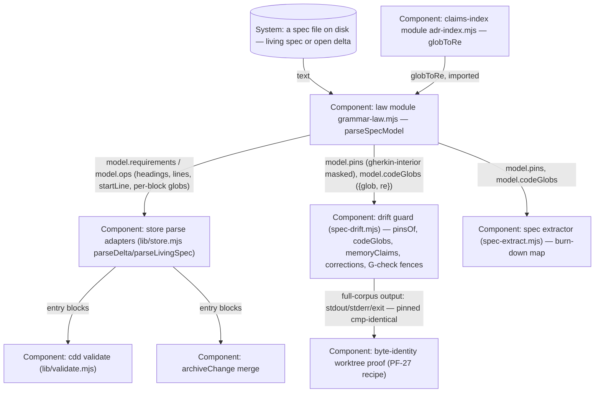

# Design — spec-model

## Level

Component. The risk lives inside the door-script set and the store's parse adapters: how one spec file becomes parsed answers (requirement blocks, delta operation blocks, fence-masked pins, compiled `Code:` globs), and which module owns that parse so every door reads the same one. The container boundary around the store (cdd/, adopting copies, the tool) is already fixed — adr-ops settled where the law modules live and how copies travel; this change moves one responsibility across existing components, it does not draw a new boundary. The Code level is banned as too fine and fastest-rotting: the internal shape of `parseSpecModel` is free to change precisely because the doors only read its answers.

## Diagram

## Boundaries
- Spec file (System: a spec file on disk — living spec or open delta): markdown carrying `### Requirement:` headings, `## ADDED/MODIFIED/REMOVED Requirements` sections (deltas), gherkin fences with `# Verified by:` pins, and `Code:` glob lines; must not be known to any door beyond the model — no door re-scans raw spec text for any of these parts.
- Law module (GL, Component: grammar-law.mjs parseSpecModel): one function parses one spec text once into requirements (every `### Requirement:` block, living semantics: block ends at a `##` non-`###` heading), ops (delta semantics: blocks only under an ADDED/MODIFIED/REMOVED section), pins (PIN_COMMENT over gherkin-fence-interior masked text — the guard's masking direction, so a lookalike outside a gherkin fence is never a pin), codeGlobs (every `Code:` line, flat, each `{glob, re}` compiled with the shared matcher), and fences (extractFences). It must not touch the filesystem (pin resolution, glob claim resolution against tracked files, and corrections logic stay with the doors — the model answers text questions only) and must not know door-specific verdicts or check tags. Its one import beyond node builtins is `globToRe` from the claims-index module — the single blessed new edge; the module cycle it closes (adr-index already imports grammar-law) is safe because both directions use each other's bindings only inside function bodies, never at module-evaluation time (hoisted function declarations; no top-level cross reads).
- Claims-index module (AI, Component: adr-index.mjs): keeps owning the glob-to-regex translation exactly once (AG2's law); must not learn spec-file structure — it answers glob compilation and ADR frontmatter, nothing else.
- Store parse adapters (Store, Component: lib/store.mjs): parseDelta/parseLivingSpec keep their exact exported shapes (`{op, requirement, block, startLine, text}` incl. the `trimEnd() + "\n"` text shaping) because validate and archiveChange consume those fields verbatim; the adapters must not add fields, drop fields, or re-shape text — they map model entries to the legacy shape and nothing more.
- Drift guard (Guard, Component: spec-drift.mjs): reads the model for pinsOf/codeGlobs (pin resolution against the filesystem stays local), memoryClaims (per-requirement globs off `model.requirements`), corrections (MODIFIED ops off `model.ops`), and the G-check (model.fences); check order, flow, tags, and report format are untouched — this change swaps where the parsed answers come from, never the per-law structure (run 2 owns that). Its full-corpus output is pinned byte-identical, so it must not change a single finding line.
- Spec extractor (Extractor, Component: spec-extract.mjs): reads the same model — after this change its pin set and glob claims agree with the guard's by construction; its private raw-text pin scan and private (pre-PF-20) globToRe are deleted, the two deliberate behavior changes land here and are pinned by the new acceptance scenarios.
- Validate (Component: lib/validate.mjs): unchanged consumer — it sees the same entry blocks through the adapters; must not learn the model exists (no new import from scripts/ for it).
- Archive (Component: archiveChange in lib/store.mjs): unchanged consumer — same entry blocks, same contract; must not learn the model exists either.
- Byte-identity proof (Proof, Component: worktree run at bc4b867): captures the guard's stdout/stderr/exit before the branch's changes, applies only the changed scripts to a clean worktree, re-runs, and cmps — the behavior-preserving half's evidence; it must not be relaxed to "tests green" (existing acceptance pins are the second half).

## Alternatives
- Put the model in a new `scripts/spec-model.mjs` door lib. Rejected: a sixth DOOR_SCRIPTS member grows every adopting store's copy set and the door surface for zero added law — the mission's shape constraint pins membership at five, and grammar-law already owns "the one law behind every door".
- Put the model in the guard (spec-drift.mjs) and let others import from it. Rejected: the extractor and the store would import the guard script (the heaviest, door-coupled consumer) for a text-only parse; the law module is the established home for shared grammar (CODE_LINE, PIN_COMMENT, extractFences already live there).
- Compile globs at the consumers, model carries glob strings only. Rejected half-way: it keeps the translation call restated at every consumer and re-opens the exact divergence this change kills (the extractor's stale private matcher); the model compiles once with the shared matcher — consumers can no longer disagree about compilation.
- Break the cycle by moving globToRe into grammar-law and re-exporting from adr-index. Rejected: AG2 pins the translation defined exactly once in scripts/adr-index.mjs; moving it would amend that living law and the "ADR claims index is single-sourced" requirement — a far bigger delta than one blessed import edge, and adr-ops already settled the matcher's home.
- Re-point the store to a re-export module instead of adapters. Rejected: parseDelta/parseLivingSpec are exported store API consumed by validate.mjs and archiveChange with exact field shapes; thin adapters over the model preserve every contract with no new module.
- Restructure the guard into pure checks over the model in the same change. Rejected: run 2's explicit scope (mission boundary); here the guard's per-law structure, check order, and report format stay as-is so the byte-identity proof stays meaningful.
