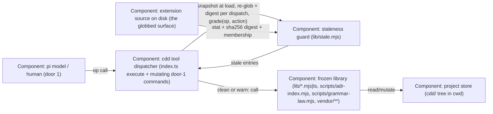

# Design — 20261025-stale-lib-guard

## Level

C4 **Component** level, inside the pi-cdd extension container. The risk lives in
one component's relationship to its peers: the tool dispatcher (`index.ts`)
calls library components whose modules the process froze at load — jiti/ESM
module caching means every edit that lands on disk after load is invisible to
the running process. Both verified instances (PF-36) executed at exactly this
component boundary: dispatch → frozen library export → wrong mutation/verdict.
No external system or container changes; a Context or Container diagram would
add boxes without locating the seam.

## Diagram

## Boundaries

- **Caller (pi model / human)**: supplies op calls and door-1 commands and receives the graded answers; must not be able to talk the guard out of a refusal (no override path) and must not need to know the surface definition or the diff mechanics.
- **Dispatch (index.ts)**: consults the guard before every op executes and before the three mutating door-1 command handlers run; renders refusal/warning. Must not know the surface globs, the diff logic, or the file-stat details.
- **Guard (lib/stale.mjs)**: owns the source-surface definition, the load-time snapshot, the per-dispatch re-glob + digest diff (membership plus per-file sha256 content digest; mtimeMs and size ride along as recorded metadata), the op grading, and the per-op fresh-node example commands. Must not know any op's implementation, the store layout, or write anything — read-only filesystem access, pure functions.
- **Frozen library**: the behavior the guard protects; must not know it is guarded (no guard calls inside lib functions) — the library stays usable standalone.
- **Extension source on disk**: truth for freshness; any writer (editor, git checkout, copy) ages the process snapshot. Never includes the project's `cdd/` store — store writes are not staleness.
- **Project store**: mutation target of ops; untouched by the guard itself.

## Alternatives

- **Fresh-spawn per mutating op** (dispatch shells out to `node -e` for every
  mutating op): always-fresh code, no staleness possible — rejected as the
  default: it changes every mutating op's failure surface (child-process
  errors, cwd/env plumbing, result marshalling) for all adopters to fix a
  dev-clone process model, and detection+refusal is sound for the class: the
  membership + per-file digest diff catches any post-load edit, and the refusal names
  the fresh-node path so the operator can spawn exactly when freshness
  matters. Fresh-spawn remains the named remedy inside the refusal message.
- **Doc-law only** (skills + role docs mandate fresh-node after lib edits):
  already the runner protocol and already tracked as the doc halves (PF-34,
  PF-38) — word-of-mouth class, cannot bind the tool itself; kept as
  complement, not the fix.
- **Stat-metadata-only diff** (membership re-glob + mtimeMs + size, no content
  read): cheapest — rejected as unsound: a same-length rewrite that preserves
  the file's mtimeMs (a filesystem timestamp tick that did not advance, or a
  tool restoring mtimes, e.g. `rsync -a`, `touch -r`) leaves both metadata
  values equal and the edit invisible — exactly the class this change exists
  to close (R1 blocker). Hashing the whole surface (~3 MB) costs milliseconds
  per dispatch, so the digest is computed on every dispatch, unconditionally —
  no metadata fast-path that could re-open the gap.
