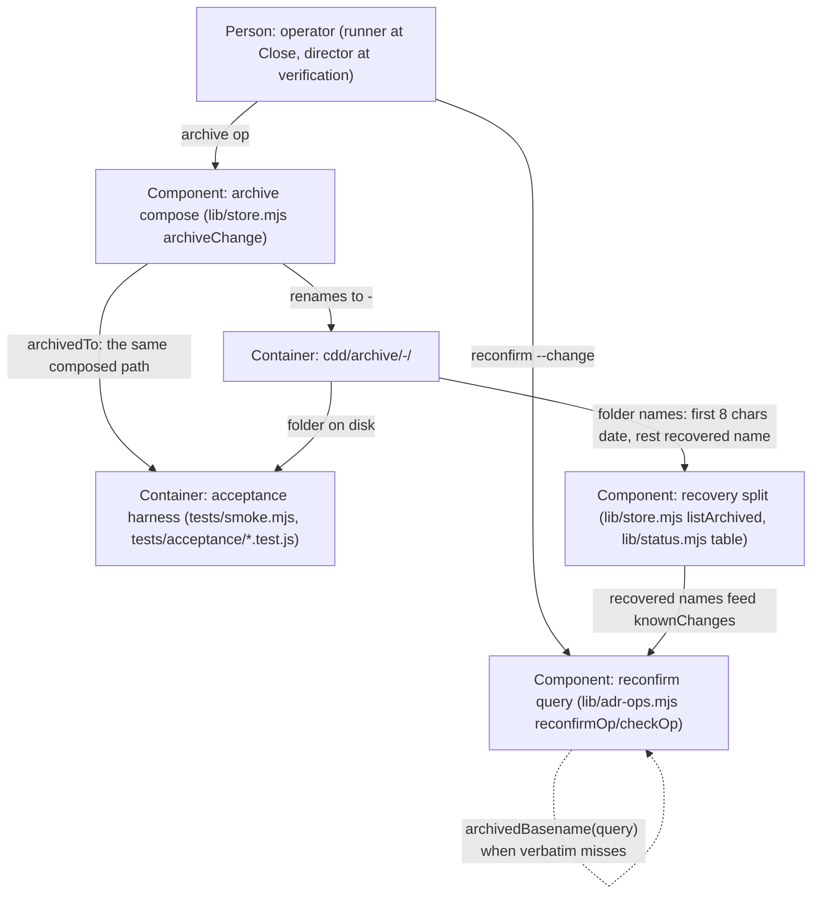

# Design — 20261025-archive-stamp-name

## Level

Component. The bet is not how the store faces users or other containers — it is how three components inside the cdd tool agree on one folder-name law: archive compose, the recovery split, and the reconfirm query. That agreement is exactly a Component-level surface; Context would hide it behind one box, and the Code level is banned (too fine, rots fastest).

## Diagram

## Boundaries

- Person: operator (runner at Close, director at verification) — invokes the archive and reconfirm ops by change name; must not know how folder names are composed or recovered.
- Component: archive compose (lib/store.mjs archiveChange) — renames the closing change folder to `<stamp>-<archivedBasename(name)>` and reports that exact path as archivedTo; must not know whether the change name was dated beyond the one strip, and must not compose the reported path independently of the rename target.
- Container: cdd/archive/<stamp>-<basename>/ — plain archive folders, one date prefix by law; must not encode whether the original change name carried a date — that information is deliberately not stored (the strip is the lossy step the recovery side compensates for).
- Container: acceptance harness (tests/smoke.mjs, tests/acceptance/*.test.js) — pins the folder-name law by importing the store lib and reading both the archive folder on disk and the reported path, asserting they name one folder; must not compose or guess archive paths — it reads the single reported path.
- Component: recovery split (lib/store.mjs listArchived, lib/status.mjs table) — splits each folder name into date (first 8 chars) and recovered name (rest), newest first; must not know the original change name or strip anything itself (folders hold exactly one date by law).
- Component: reconfirm query (lib/adr-ops.mjs reconfirmOp/checkOp) — matches a --change query against knownChanges, verbatim first, then the query stripped of at most one leading date segment via the same helper; must not know folder layout beyond the recovered names the split hands it.

## Alternatives

- Compose-only strip (no recovery alignment) — rejected at M0: fixes the cosmetics, trades them for a functional defect — a dated change name becomes unresolvable for post-archive `reconfirm --change` because the folder can no longer say whether the name was dated.
- Strip at the name (mutate the change name) — rejected: the name is identity (branch, tasks, reviews, backlog premises cite it); renaming mid-flight breaks more than it heals.
- Drop the archive stamp prefix (folder = name verbatim) — rejected: loses archive-date chronology and collides same-named changes archived on different days.
- Stop date-prefixing change names — rejected: fixes nothing existing; the five doubled folders stay doubled.
- A name-validation law (reject date-prefixed names at the door) — rejected as a Non-Goal: bare names must archive lawfully, and dated mission names are director-era practice the store must serve, not police.
